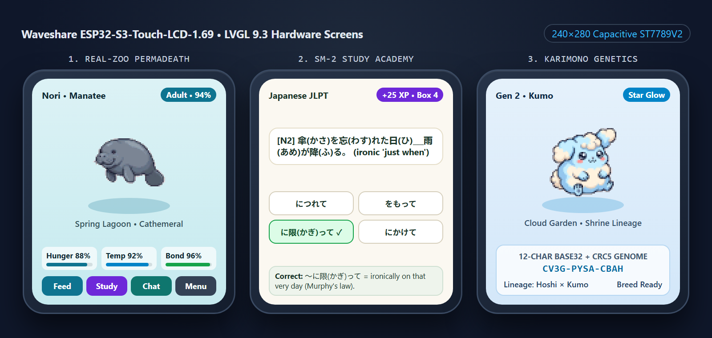
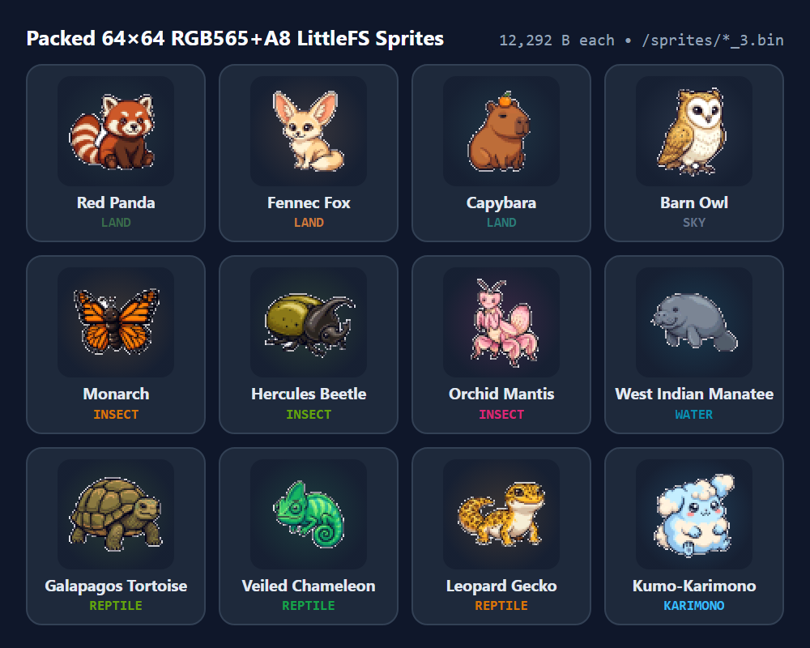
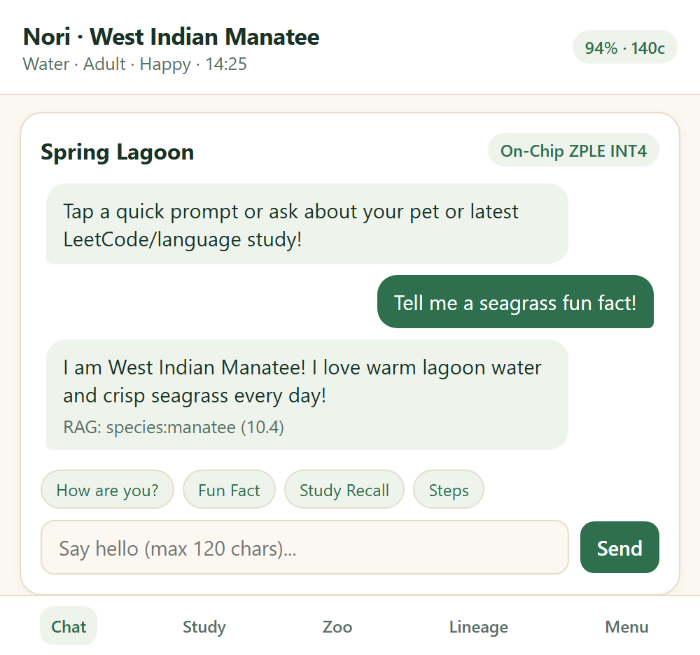

<div align="center">

# ZooGotchi S3

**A pocket-sized virtual pet, study buddy, and wellness coach for the Waveshare ESP32-S3-Touch-LCD-1.69 — zero PC required.**


<br>



</div>

---

## Choose Your Companion

Adopt one of **18 companions across 6 biomes**. Real animals follow authentic day/night rhythms and real **permadeath** (leaving a sanctuary memorial), while mystical **Karimono** can **cross-breed** across generations via offline Plaza spirits or shareable **12-char Base32 Genome Codes**.

<div align="center">
  
</div>

| Biome | Species Roster | Signature Twist |
| :--- | :--- | :--- |
| **Land** | Red Panda, Fennec Fox, Capybara | Diurnal / nocturnal / crepuscular habits & real-animal permadeath |
| **Sky** | Barn Owl, Scarlet Macaw, Ruby Hummingbird | High-metabolism flight care & species chirps |
| **Insect** | Monarch Butterfly, Hercules Beetle, Orchid Mantis | True metamorphosis stages (Larva -> Pupa -> Imago) |
| **Water** | **West Indian Manatee**, Axolotl, Giant Pacific Octopus | Warm-lagoon / tank habitat care & seagrass grazing |
| **Reptile** | Galapagos Tortoise, Veiled Chameleon, Leopard Gecko | Slow longevity & mood-reactive chameleon color shifting |
| **Karimono** | Hoshi-Karimono, Kumo-Karimono, Kuro-Karimono | Mendelian + mutation cross-breeding across generations (`/lineage.json`) |

---

## What's Inside the Pocket Game

- **Care & Lifecycles:** Keep 7 vitals balanced (`Hunger`, `Hydration`, `Habitat Care`, `Enrichment`, `Energy`, `Health`, `Bond`), evolve personalities along 4 axes, spend Zoo Coins on Scholar Glasses & treats in the Zoo Shop, and preserve tributes in `/memorial.json`.
- **Play (Touch, Tilt & Sound):** Pet your companion right on the LCD, rock the device gently for a lullaby, and play 3 mini-games — **Forage Catch** (IMU tilt), **Habitat Care** (tap), and **Rhythm Chirp** (passive buzzer).
- **Study Academy & Focus Buddy:** Drill **106 SM-2 flashcards** across 5 decks (*LeetCode Patterns*, *Big-O & Edge*, *Spanish*, **Japanese JLPT N4–N1 with native kanji + inline furigana**, and *Zoo Biology*), upload up to **40 custom cards** from your phone, and run 15m / 25m / 35m Focus sprints to teach your pet new terms.
- **Health & Step Coach:** Pocket pedometer (`QMI8658C`, keeps counting while walking with the screen off) with configurable daily step goals, automatic `PCF85063A` midnight rollover, 7-day history & streak tracking, hydration cup logging that hydrates your pet too, gentle daytime move/water nudges, and a 1-minute **`4-4-4-4` guided breathing** coach.
- **Offline Companion Brain & Phone Web Studio:** Talk to your pet 100% offline via the on-chip INT4 PLE micro-LLM + 3-layer safety guardrails + on-device BM25 RAG, or double-press `PWR` and scan the on-screen QR code to open the local Web Studio (`http://192.168.4.1`).

---

## Controls Manual

| Input | Action | What It Does |
| :--- | :--- | :--- |
| **Touch** | Tap Pet | Ask your companion to speak (`Micro-LLM / Personality Engine`) |
| **Touch** | Stroke Sprite | Pet for affection & purrs |
| **Touch** | Tap Step Bar | Open **Health & Goals** (arc, water tracker, 1m breathing) |
| **Touch** | Swipe Right / Left / Up / Down | Care / Field Journal / Study Academy / Settings & Wi-Fi QR (Down exits mini-game) |
| **Motion** | Walk / Gentle Rock / Tilt & Shake | Count steps in pocket / Trigger lullaby / Steer **Forage Catch** (hard shake = dizzy!) |
| **`PWR` Button** | Short / Double / Hold `2.5s` | Screen sleep (steps stay active) / Toggle Wi-Fi QR / Atomic save & power off |
| **`BOOT` Button** | Short Press | Exit mini-game or return Home |

---

> [!CAUTION]
> **Battery & Coin Cell Hardware Safety (Read Before Plugging In)**
> 1. **1000mAh LiPo (`MX1.25`):** Always check Red (`+`) / Black (`-`) polarity against the Waveshare PCB silkscreen — generic LiPo packs are frequently wired backwards and can damage the `ETA6098` charger.
> 2. **RTC Backup Cell (`SH1.0`):** Use **only a rechargeable coin cell** (`ML414` or `MS621FE`) — never a primary `CR`-series battery.
>
> Printed enclosure tolerances & M2×6mm boss specs: [`hardware/enclosure_notes.md`](hardware/enclosure_notes.md).

---

## Quick Start (Build & Flash)

```powershell
# 1. Generate Web UI bundle & verify project invariants
.\.venv\Scripts\python.exe tools\build_web_gz.py
.\.venv\Scripts\python.exe test\verify_zoogotchi_suite.py

# 2. Build & flash firmware + LittleFS assets (Waveshare ESP32-S3-Touch-LCD-1.69)
.\.venv\Scripts\pio.exe run -e waveshare_s3_169 -t upload
.\.venv\Scripts\pio.exe run -e waveshare_s3_169 -t uploadfs
```

*(Zero external microSD needed: `firmware.bin` and `littlefs.bin` pack all sprites, web UI, Japanese LVGL font, and RAG index onto the 16 MB onboard Flash.)*

---

<details>
<summary><b>Phone Companion Studio Preview</b></summary>

<br>
<div align="center">
  
</div>

</details>

<details>
<summary><b>Modding & Where to Edit</b></summary>

| Customization Area | Location |
| :--- | :--- |
| **Species & Biomes (6 headers × 3)** | [`src/zoo/categories/`](src/zoo/categories/) (`land.h`, `sky.h`, `insect.h`, `water.h`, `reptile.h`, `karimono.h`) |
| **Study Flashcard Decks** | [`src/learn/decks/`](src/learn/decks/) (`dsa_patterns.h`, `dsa_bigo.h`, `spanish.h`, `japanese_jlpt.h`, `zoo_bio.h`) |
| **Health Goals & Guided Breathing** | [`src/health/`](src/health/) (`health_tracker.h`, `health_tracker.cpp`) |
| **Mini-Games** | [`src/game/minigames/`](src/game/minigames/) (`forage_catch.cpp`, `habitat_care.cpp`, `rhythm_chirp.cpp`) |
| **Micro-LLM, BM25 RAG & Safety** | [`src/ai/`](src/ai/) (`micro_llm_ple.cpp`, `rag_retriever.cpp`, `safety_guardrails.cpp`, `personality_memory.cpp`) |
| **Japanese LVGL Font & Pixel Sprites** | [`src/display/zoo_font_jp_12.c`](src/display/zoo_font_jp_12.c), [`data/sprites/`](data/sprites/) |
| **Phone Companion Web App** | [`web_ui/index.html`](web_ui/index.html) (packed into `data/web/index.html.gz`) |
| **Training, Hybrid RAG & Benchmarks** | [`llm_training/`](llm_training/) (`data_pipeline/`, `rag/`, `post_training/`, `eval/`, `tracking/`) |

</details>

<details>
<summary><b>Under the Hood: On-Device RAG, INT4 Micro-LLM & Asset Generators</b></summary>

- **On-Device & Hybrid RAG:** Binary BM25 index [`data/rag/kb.bin`](data/rag/kb.bin) (`53,304 B`, `109` chunks across species, DSA, JLPT N4–N1 Japanese+English, health goals, genetics, and hardware) queried on-chip via `/api/rag`; benchmarked host-side against **BM25 Sparse vs. Dense SVD vs. Hybrid RRF** (`llm_training/rag/hybrid_rag.py`: `R@1 = 1.000`, `nDCG@5 = 0.971`).
- **On-Chip Micro-LLM Post-Training:** Zero-leakage curated dataset -> `Base SFT` -> `LoRA SFT` -> `GRPO` vs. `SAPO` alignment -> `3.54 MB` INT4 `ZPLE` weights flashed to `0x610000` (`zoo_pet.bin`, `0.9992` C++ parity) backed by an audited 1,421-word safe output vocabulary (`include/zoo_vocab_out.h`).
- **Asset & Font Generators (Gemini API & Local):**
  ```powershell
  # Top up missing 64x64 pixel sprites (requires GEMINI_API_KEY)
  .\.venv\Scripts\python.exe tools\generate_zoo_sprites.py --missing-only --pack

  # Generate custom study deck (e.g. JLPT with kanji+furigana or NeetCode)
  .\.venv\Scripts\python.exe tools\generate_study_deck.py --topic "JLPT N2" --count 15

  # Rebuild ZRAG binary index, JP bitmap font, or run GPU post-training suite
  .\.venv\Scripts\python.exe tools\build_rag_index.py
  .\.venv\Scripts\python.exe tools\build_jp_font.py
  .\.venv\Scripts\python.exe llm_training\post_training\run_post_training_suite.py
  ```
- **Deep Docs & Benchmarks:** [`docs/ARCHITECTURE.md`](docs/ARCHITECTURE.md) | [`docs/BENCHMARK_REPORT.md`](docs/BENCHMARK_REPORT.md) | [Training & RAG Curves](docs/assets/training_curves.svg)

</details>

---

Licensed under the **Apache License, Version 2.0** ([`LICENSE`](LICENSE)). See [`NOTICE`](NOTICE) for hardware bring-up attribution.
