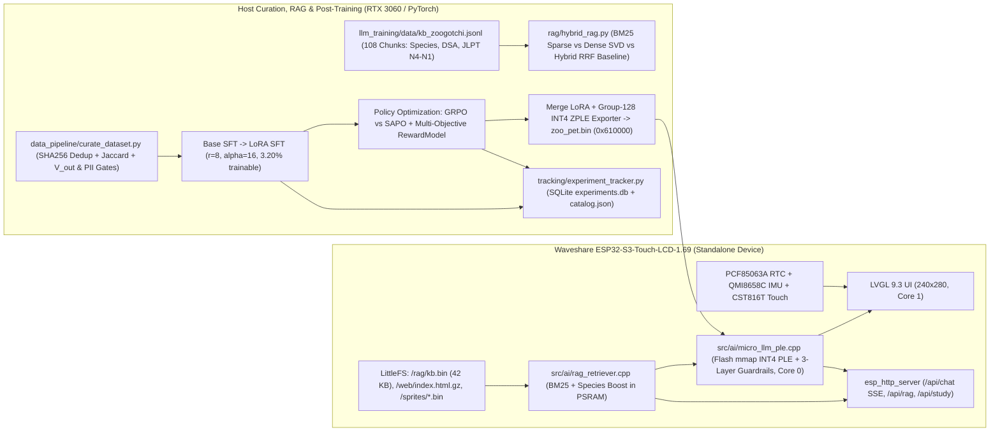

# ZooGotchi S3 — System, On-Device RAG & Post-Training Architecture

## 1. End-to-End Hardware, On-Device RAG & Post-Training Architecture

## 2. Core Design Choices

- **Asymmetric Safety by Construction (`V_out` + Runtime Guardrails):**
  - Instead of letting a quantized tiny transformer sample arbitrary subwords, the output head is constrained to a strictly audited safe vocabulary (`ZOO_VOUT_COUNT = 1,421` in `include/zoo_vocab_out.h`), layered behind input prompt-injection sanitization and runtime output verification (`src/ai/safety_guardrails.cpp`).
- **On-Device Compact Binary BM25 (`ZRAG` v1):**
  - `tools/build_rag_index.py` packs 108 verified species biology, NeetCode DSA, JLPT N4–N1 grammar, Karimono genetics, and hardware chunks into `data/rag/kb.bin` (`42,216 B`, CRC32-checked). Binary search over sorted FNV-1a hashes and heap-allocated BM25 scoring keep Core 0 HTTP/brain stacks safely below their `8192 B` limits, while `llm_training/rag/hybrid_rag.py` benchmarks sparse BM25 against dense SVD and Hybrid RRF on the host.
- **Compositional Input Hashing vs Target Alignment:**
  - `src/ai/personality_memory.cpp` emits space-separated `[SP:...] [ST:...] [MD:...] [TR:...] [TM:...] [MEM:...]` tags and `micro_llm_ple.cpp` injects `[RAG:<tag>]` dynamically when retrieved score >= `1.2f`, enabling orthogonal Per-Layer Embedding composition across unseen state combinations.
- **LoRA SFT -> GRPO vs SAPO -> C++ Parity:**
  - `llm_training/post_training/lora.py` adapts attention + SwiGLU FFN projections (`3.20%` of weights), `policy_opt.py` compares clipped **GRPO** against smooth asymmetric **SAPO**, `merge_and_unload_lora()` folds deltas into zero-overhead `nn.Linear` layers, and `ZpleNumpyRuntime` verifies Group-128 INT4 dequantization parity against `micro_llm_ple.cpp`.
