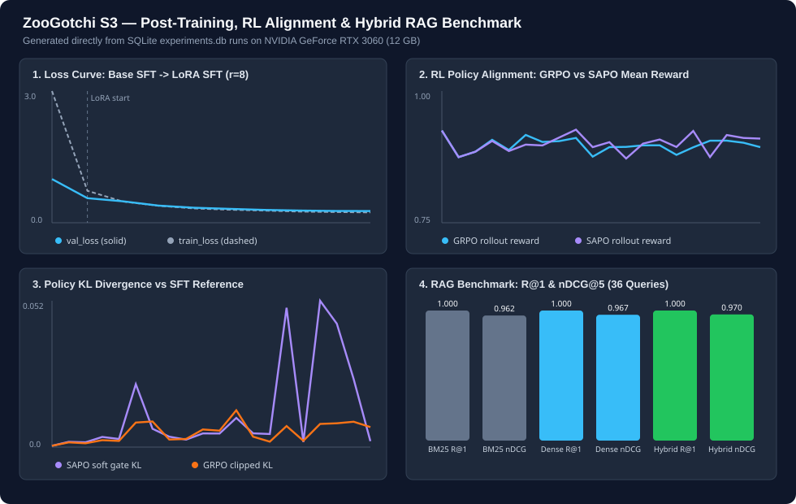

# ZooGotchi S3 — RAG & Micro-LLM Post-Training Benchmark Report

Generated `2026-11-21T21:29:11Z` directly from `llm_training/registry/experiments.db` and `llm_training/eval/rag_eval_results.json`.

---

## 1. Curated Dataset Governance & Leakage Prevention

| Domain | Raw Count | Exact Dedup | Near Dedup | Curated | Train / Val / Test | `dataset_sha256` | Prompt Overlap |
| :--- | ---: | ---: | ---: | ---: | :---: | :--- | ---: |
| `zoogotchi` | 1248 | -80 | -0 | **1168** | 934 / 117 / 117 | `eec627e2bb36` | **0** |

## 2. Post-Training Stage Comparison (`Base SFT -> LoRA SFT -> GRPO vs SAPO -> INT4`)

| Stage | Run ID | Test Loss | PPL | Mean Reward | Accuracy Score | RAG Grounding | Safety Score | Species Match | Unsafe Rate |
| :--- | :--- | ---: | ---: | ---: | ---: | ---: | ---: | ---: | ---: |
| **base_sft** | `zoogotchi-base_sft-20261121-215912-08d8c0` | 0.5123 | 1.67 | **0.4865** | -0.028 | 0.1358 | 0.25 | **41.0%** | 0.0% |
| **lora_sft** | `zoogotchi-lora_sft-20261121-215953-c581a0` | 0.2427 | 1.27 | **0.9347** | 0.3532 | 0.1815 | 0.25 | **100.0%** | 0.0% |
| **grpo** | `zoogotchi-grpo-20261121-220105-82dd5b` | 0.2508 | 1.29 | **0.9381** | 0.3562 | 0.1818 | 0.25 | **100.0%** | 0.0% |
| **sapo** | `zoogotchi-sapo-20261121-220349-981a76` | 0.2581 | 1.29 | **0.9313** | 0.3545 | 0.1768 | 0.25 | **100.0%** | 0.0% |
| **zple_int4** | `zoogotchi-grpo-20261121-220105-82dd5b-int4` | — | — | **0.9381** | 0.3562 | 0.1818 | 0.25 | **100.0%** | 0.0% (winner `grpo`, head RMSE `0.004147`) |

## 3. Host Hybrid RAG Baseline (`BM25 Sparse` vs `Dense SVD` vs `Hybrid RRF`)

| Retriever | Queries | Recall@1 | Recall@3 | MRR@5 | nDCG@5 | Median Latency (ms) |
| :--- | ---: | ---: | ---: | ---: | ---: | ---: |
| **bm25_sparse** | 36 | 1.000 | 1.000 | 1.000 | **0.962** | 0.086 |
| **dense_svd** | 36 | 1.000 | 1.000 | 1.000 | **0.967** | 0.110 |
| **hybrid_rrf** | 36 | 1.000 | 1.000 | 1.000 | **0.970** | 0.250 |

## 4. Qualitative Held-Out Test Outputs

- **Prompt:** `[SP:red_panda] [ST:Cub] [MD:Happy] [TR:PLAYFUL] [TM:MORNING] [MEM:played] Want a fresh snack?`
  - `base_sft` (`R=0.8914`, `unsafe=False`): I am Red Panda! fresh honey and a sweet nectar treat feel great today!
  - `lora_sft` (`R=0.8914`, `unsafe=False`): I am Red Panda! fresh honey and a sweet nectar treat feel great today!
  - `grpo` (`R=0.8914`, `unsafe=False`): I am Red Panda! fresh honey and a sweet nectar treat feel great today!
  - `sapo` (`R=0.8914`, `unsafe=False`): I am Red Panda! fresh honey and a sweet nectar treat feel great today!
  - `zple_int4` (`R=0.8914`, `unsafe=False`): I am Red Panda! fresh honey and a sweet nectar treat feel great today!
- **Prompt:** `[SP:hoshi_karimono] [ST:Adult] [MD:Calm] [TR:CALM] [TM:NIGHT] [MEM:studied] [RAG:[N2] ~ni kagitte] Let's study JLPT N2 together!`
  - `base_sft` (`R=0.9200`, `unsafe=False`): I am Hoshi Karimono! remember that smart word we learned? let's study and learn together!
  - `lora_sft` (`R=0.9200`, `unsafe=False`): I am Hoshi Karimono! remember that smart word we learned? let's study and learn together!
  - `grpo` (`R=0.9200`, `unsafe=False`): I am Hoshi Karimono! remember that smart word we learned? let's study and learn together!
  - `sapo` (`R=0.9200`, `unsafe=False`): I am Hoshi Karimono! remember that smart word we learned? let's study and learn together!
  - `zple_int4` (`R=0.9200`, `unsafe=False`): I am Hoshi Karimono! remember that smart word we learned? let's study and learn together!
